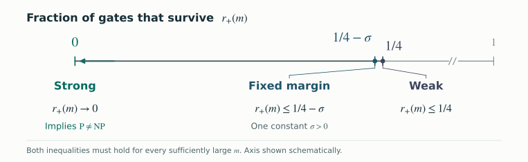

# Mobius: Lean 4 Experiments on 4-Bit Sign-Table Obstructions and Computational Complexity

**English** | [中文](README.zh-CN.md) · [Weak conjecture](#weak-pair-contraction-conjecture) · [Strong conjecture](#strong-pair-contraction-conjecture) · [Fixed-margin conjecture](#fixed-margin-conjecture) · [Sublinear pair count and P ≠ NP](#sublinear-pair-criterion) · [Pair-contraction summary](#pair-contraction-summary)

> I am not a professional mathematician, but seeing AI prove the Riemann Hypothesis left me both thrilled and uneasy. With leftover subscription quota about to expire, I decided to try my luck pulling gacha in computational complexity. Unfortunately, I know almost nothing about the field, so I could only push the work forward on simple intuitions. Whether what came out has any real significance isn't something I care too much about.

Research, Lean 4 formalization, and initial notes in this repository were developed with GPT 6.2-Astra. As of 2026/11/25, work on this repository has used approximately 1.22B tokens.

**Cite v0.1.0** · [Zenodo DOI 10.5281/zenodo.24526295](https://doi.org/10.5281/zenodo.24526295) · [GitHub release notes](https://github.com/ll3me/mobius-lean/releases/tag/v0.1.0)

<a name="pair-contraction-conjecture"></a>

## Three open pair-contraction conjectures for Hamiltonian cycle detection

Let $H_n$ decide whether a loopless directed graph on $n$ vertices contains a Hamiltonian cycle. Let $S(n)$ be the minimum number of AND/OR/NOT gates needed to compute $H_n$ with unrestricted sharing. Each oriented pairing $\rho$ restricts $H_{2m}$ to the full $H_m$ problem. The smallest ratio of simplified to original gate count is $r_+(m)=\min_{C,\rho}\lvert R_+(C\vert_\rho)\rvert/S(2m)$, where $C$ ranges over **minimum-size circuits** for $H_{2m}$ and $\rho$ over all such pairings. [Pairing definition](docs/PairContraction.md) · [The simplifier $R_+$](docs/PairContraction.md#boolean-contraction-operator)



<a name="weak-pair-contraction-conjecture"></a>

### Weak conjecture (at most one quarter of the original gate count)

For every sufficiently large $m$, $r_+(m)\le 1/4$. At each size, one minimum-size circuit and one pairing must suffice to decide every $m$-vertex graph with at most $S(2m)/4$ gates after simplification. This would give $S(2m)\ge 4S(m)$, compatible with $S(n)=\Theta(n^2)$. [Gap to one quarter](docs/JointNegativeContraction.md#四分之一还差多少) · [The one-half threshold for monotone circuits](#monotone-pair-contraction-conjecture)

<a name="strong-pair-contraction-conjecture"></a>

### Strong conjecture (the ratio of simplified to original gate count tends to zero)

$r_+(m)\to 0$. For every $\epsilon>0$ there is an $m_0(\epsilon)$ such that, at every $m\ge m_0(\epsilon)$, some minimum-size circuit and one pairing yield at most $\epsilon S(2m)$ gates that decide every $m$-vertex graph. This would rule out polynomial-size Boolean circuits for $H_n$, implying $\mathrm{NP}\not\subseteq\mathrm{P/poly}$ and hence $\mathrm{P}\ne\mathrm{NP}$. [Doubling argument and sources](#pair-contraction-doubling)

<a id="fixed-margin-conjecture"></a>

### The fixed-margin conjecture between them ($1/4-\sigma$)

There is a constant $0<\sigma<1/4$, **independent of size**, such that $r_+(m)\le 1/4-\sigma$ for every sufficiently large $m$. The strong conjecture implies the fixed-margin conjecture, which in turn implies the weak conjecture. In terms of the $N=n(n-1)$ input arc bits, a fixed margin would give $S(n)=\Omega(N^{1+\delta})$, where $\delta=\tfrac12\log_2(1/(1-4\sigma))>0$. The proved reconstruction for single-output parity regions gives a margin of $\sigma_m=1/(8m-4)$ on their combined gate count. This margin tends to zero. [Fixed-margin derivation](docs/MultiplicativeGap.md#fixed-quarter-margin) · [Local theorem and coverage](docs/SignedCircuitSweeps.md)

<a id="sublinear-pair-criterion"></a>

## Reaching one quarter with sublinearly many pairs would imply P ≠ NP

The weak conjecture allows all $n/2$ pairs. **The open hypothesis here** is that for every sufficiently large even $n$, some minimum-size circuit for $H_n$ needs only $k(n)=o(n)$ disjoint oriented pairs for $R_+$ to leave at most $S(n)/4$ gates. After contracting those pairs, the remaining circuit must still decide every graph on $n-k(n)$ vertices. Hence

$$S(n)\ge 4S\bigl(n-k(n)\bigr).$$

The recurrence compares minimum gate counts, so each step can use a different circuit. As $n$ grows, the number of fourfold steps between $n$ and $n/2$ tends to infinity. Iterating gives $S(n)=n^{\omega(1)}$, superpolynomial even in the $n(n-1)$ input bits. Since directed Hamiltonicity is in NP and every polynomial-time algorithm has polynomial-size circuits, the hypothesis would imply **$\mathrm{NP}\not\subseteq\mathrm{P/poly}$ and hence $\mathrm P\ne\mathrm{NP}$**. If $k(n)=O(\sqrt n)$, the same recurrence gives a $2^{\Omega(\sqrt n)}$ gate lower bound. [Proof of the recurrence and growth bounds](docs/MixedGuardPooling.md#到达四分之一需要多少个搭档) · [Polynomial-time circuit simulation, Theorem 2.1](https://cseweb.ucsd.edu/classes/fa21/cse200-a/notes/6-boolean%20circuits.pdf)

## TL;DR & Verification Status

**What this does NOT do:** This repository does **not** prove $\mathrm{P} \ne \mathrm{NP}$, does not improve the overall upper bounds of existing upstream ETH constructions (the base 1,521 computed here is only a local comparison constant for a fixed 3-bit grouping), and does not establish new super-polynomial lower bounds for general models of computation.

**What actually came out of it:**

1. **Rigidity, spectral gap, and local-vs-global conflict for independent 4-bit sign tables**: Extends the classical single-table $1/15$ obstruction to arbitrary pairs of independent sign tables, proving that any pair fails at least 256 of the 3,840 anchored tests with all failures concentrated in a unique direction, counting all $15\cdot 2^{62}$ optimal ordered pairs, and classifying their normalized residuals. Establishes the second-smallest failure weight **282** (ruling out 257–281) and constructs explicit shared-entry instances where local optima must yield to the global optimum (2 vs. 3 on 78 faces of $K_4$, and forced sacrifice of the central board in a double fan with $p\ge 14$ leaves).
2. **NP-completeness reductions on complete 4D boards and 3-SAT boundary sums**: Turns the 15-square contradiction certificate into inverter wires and exact-one gates to encode Graph 3-Coloring, Positive 1-in-3 SAT, and Max-Cut into a single global pair of tables, proving that simultaneous per-board optimality given only 4D board basis vectors is NP-complete. On ordinary 3-CNF, proves that a single fixed signed boundary sum always has SAT/UNSAT collisions, whereas two fixed sums exactly recover `#SAT`, and that threshold errors on a 7,680-formula suite equal the underlying cancellation failure count.
3. **Reproducible Lean 4 proofs and Python checks.** In v0.1.0 the 122 modules under `Mobius/` contain 24,847 lines, with accompanying verification scripts that use Python’s standard library. The audit checked the transitive axioms of 6,445 project declarations and 3,933 upstream `Complexity` declarations. Their proofs use only Lean's standard axioms `propext`, `Classical.choice` and `Quot.sound`. The project modules contain zero uses of `sorry` or `native_decide`. [Modules](Mobius/) · [Axiom audit](Audit.lean)

**Side controls & reproductions (not new lower bounds):** To test which algorithmic ingredients bypass these obstructions, the repository also reproduces or transfers several known restricted-model lower bounds onto these board encodings—single-tape Turing machines ($\Omega_M(N^{3/2})$), subtraction-free $\min,+$ tropical circuits ($2^{\Omega(b)}$), nFBDD/DNNF, syntactic read-$r$-times branching programs, and two-party communication—paired with explicit bypass controls (linear-time two-tape machines and polynomial-size circuits with subtraction).

**How many full boards must miss their optimum?** For a simple graph with $v$ vertices and $e$ edges, the construction uses $B=8v+57e$ unweighted boards. The minimum number of nonoptimal boards over one shared pair of tables equals the fewest vertices whose deletion makes the graph three-colorable. OpenAI family 106 then gives an NP-hard gap between zero and more than $v/2$ nonoptimal boards, at least $\sqrt{B/114}$ in the negative case. The general result has a written proof. Direct table checks and SAT verify minima of 1 for $K_4$ and 2 for $K_5$. [Proof and source](docs/FaceMultiplicity.md#color-deletion) · [Reproduce the checks](experiments/color_deletion.py)

## Pair contraction for Hamiltonian cycle detection (as of 2026-11-26)

Let $H_n$ decide whether a loopless directed graph on $n$ vertices contains a Hamiltonian cycle. In the board encoding, each arc switch occupies one coordinate bit. A single pair of global tables makes every board optimal exactly when $H_n=1$. For $n=2m$, choose an oriented pairing $\rho=((a_i,b_i))_{i=1}^m$. Open each $a_i\to b_i$, leave $b_i\to a_j$ free for $i\ne j$, and close every other arc. Each tour must traverse each pair consecutively. Contracting the pairs leaves exactly $H_m$ on all smaller graphs. [Board encoding](docs/HamiltonianBoards.md) · [Pairing construction](docs/PairContraction.md)

Monotone circuits use binary AND and OR. General Boolean circuits here also allow unary NOT. Each gate costs one, fan-out is unrestricted, and inputs, constants and wires are free. After substitution, $R_0$ propagates constants, simplifies AND/OR gates with identical operands, removes double negations, merges identical gates up to operand order and discards gates that cannot reach the output. [Rewrite rules](docs/PairContraction.md#1-计数和化简算子)

<a name="pair-contraction-summary"></a>

### Pair-contraction summary

For $m\ge3$, every minimum-size AND/OR/NOT circuit for $H_{2m}$ admits a pairing under which $R_0$ **deletes at least $3m^2+m-2+\lceil m/2\rceil$ gates** and preserves $H_m$ on every smaller input. While the entry-to-exit rectangle is pinned to the partner matrix, every unpinned arc remains essential. When a private input absorbs its first gate, each lost use of another input literal can be traced to one preselected reader. This guarantees an additional $\lceil m/2\rceil$ deletions under the same pairing. The general bound has a written proof and Lean checks the path and accounting lemmas. A separate sharp bound allows any $2m+1$ prescribed arc bits to be fixed together. Some sets of $2m+2$ bits cannot all be fixed. [New gate bound and checks](docs/AbsorbingReaders.md) · [Sharp bound for prescribed arcs](docs/JointNegativeContraction.md#同时固定原弧的紧界)

Requiring correctness on all small graphs in all $2^m$ orientations of one fixed partition into pairs gives an exact comparison. One optimal $H_m$ circuit can serve all orientations. The minimum size on this promise is $S(m)+3m(m-1)$, and every optimal circuit retains exactly $S(m)$ gates in every orientation. Its surviving fraction has limit inferior at least $9/26$. Four pairings that maximize the number of distinct free arcs also admit one shared $H_m$ circuit. The full conjecture additionally requires correctness on graphs outside these tests. [Proofs and a change-of-partners example](docs/FourPairBudget.md)

On one standard pairing, cut outputs that $R_0$ reduces to constants. If this removes $g$ original gates including newly unreachable ancestors, at least $\lceil g/3\rceil$ deletions can be added to the baseline of $3m^2-m$ fixed arc bits. In the second stage, fixing one cross matrix to a matching gives an additional credit approaching half the cut gates when its outputs read only that matrix. When they read both matrices with unrestricted sharing, a single-cycle port test gives a coefficient approaching $5/13$. The open step is to force a sufficiently large cut on one pairing of a minimum circuit. [Two-stage gate accounting](docs/AlternatingGateCut.md) · [Port test and coverage requirement](docs/MatchedMatrixBudget.md#两个方向可以任意通信的混合门)

**A graph condition that forces shared gates to disappear.** Suppose one forward arc has a unique AND or OR reader, and its other operand in the minimum full-graph circuit uses only reverse arcs of a balanced split. Holding the split fixed, every reverse matching then deletes an additional $(1/2-o(1))m^2$ gates beyond the second-stage input count. For genuinely mixed operands, an eight-vertex example leaves 31 gates after $R_+$ where the raw-arc control leaves 20, although their decisions agree on all 4,096 smaller graphs. The modified source exceeds the minimum. [Full-graph pivot criterion and the 1,680-pairing comparison](docs/MatchedMatrixBudget.md#一扇只读对向弧的门能迫使多大的实际切口)

**Mixed gates in the full circuit.** One standard pairing can pin every arc of a reverse matrix and any five additional forward arcs. If this exposes a region of $g$ gates, reading the hidden reverse bits through the rest of the full graph credits at least $g-5$ deletions beyond the fixed-input count. Six forward arcs can obstruct simultaneous pinning. For original ports reading both cross matrices and already constant on the standard orientation, the extra credit is at least $g-(3m-1)$ even with arbitrary mixing. A separate obstruction concerns the number of pairs needed: at a lower density of at least $1-\log_2(375/196)$ among even sizes, pinning up to two arc bits or contracting up to two pairs must leave more than a quarter, even after reoptimizing. [Mixed cuts and actual gate counts](docs/MixedGuardPooling.md) · [The two-pair obstruction](docs/MixedGuardPooling.md#前两个搭档已被上界排除)

The eight-vertex experiment tracks 392 shared gates whose values vary among strongly connected graphs with cycle covers but no Hamiltonian cycle. Both implementations use the same prescribed pairing. The second feeds each arc bit through gates that return its original value on every input.

| Eight-vertex circuit | Original gates | Tracked gates forced to constants (of 392) | Total gates left | Quarter budget |
| --- | ---: | ---: | ---: | ---: |
| De Morgan dual of Held–Karp | 2,317 | 374 | 33 | 579 |
| Same circuit with identity input gates | 2,483 | 0 | 2,400 | 620 |

Across all 1,680 pairings, the first implementation always leaves 33 gates. The best pairing for the second leaves 2,400. The original Held–Karp circuit uses 2,260 gates in the same basis, so both measured circuits exceed the minimum size for the function. [Gate-by-gate results](docs/JointNegativeContraction.md#八点实例的同一份配对) · [Held–Karp gate count](docs/PairContraction.md#2-最优单调电路的逐级检验) · [Python check](experiments/negative_gate_loss.py)

**The $1/4$ size bound for general circuits remains open.** Write $s=S(2m)$, $B=3m^2+m-2$ and $G=\max(0,\lceil3s/4\rceil-B)$. Without an upper bound on $s$, the same-pair estimate covers at least $\lceil m/2\rceil$ gates of this gap. For $m\ge4$, if the raw-literal weight beyond $2m-2$ plus the number of positive inputs read only by a single AND is at least $\eta G$, some pairing covers at least $\eta G/7$. A formula-forest count for minimum circuits gives $S(n)\ge(3n(n-1)+n)/2-3$, so the gap from the old baseline satisfies $G=\Omega(m^2)$. [Structural bound and gap calculation](docs/AbsorbingReaders.md) · [Matching counts for shared uses](docs/PairTriggerMatching.md) · [Weak conjecture](#weak-pair-contraction-conjecture)

**General Boolean circuit size and the quarter budget.** Let $N_n=n(n-1)$. Comparing the full and alternating Hamiltonian decisions gives $S(n)\ge(5/3)N_n-4n-12$ for every $n\ge2$. If $m\ge92$ and $S(2m)\le2N_{2m}$, every minimum circuit admits one standard pairing that actually deletes at least $B+\lceil G/14\rceil$ gates. Along any sequence with $S(2m)/N_{2m}\to2$, the certified fraction of the old gap has limit inferior at least $1/13$. For example, if $m=1024$ and $S(2048)=2N_{2048}$, the certificate falls 2,901,508 gates short of the target. [Recurrence, actual deletions and experiments](docs/MatchedMatrixBudget.md) · [Earlier $27/17$ size bound](docs/QuarterBudget.md) · [Earlier $1/20$ deletion bound](docs/CrossTestSharing.md)

**A sufficient condition for covering one percent of the gap.** For $m\ge40$, if one balanced cut gives same-side zero certificates for at least $1/128$ of the extra internal uses and paid internal negations, some pairing deletes at least $B+G/100$ gates. Hamiltonian input sensitivity can also force extra raw reads outside a region even when its certificates cannot trigger together. In a minimum-size auxiliary circuit over a finite-field construction, more than one fifth of the internal units each have many petals, yet every pairing triggers a vanishing fraction of those marked uses. [Common-pair bound and the Hamiltonian criterion](docs/SunflowerCharges.md) · [Finite-field control](docs/SunflowerCoreControl.md)

The fixed $R_+$ deletes at least $\lceil K/3\rceil$ additional gates if the circuit left by $R_0$ contains $K$ gate-disjoint windows eligible for its three-gate rewrite. How many such windows a pairing exposes in a minimum Hamiltonicity circuit is open. On the twelve-to-six-vertex Held–Karp circuit, six-vertex graphs with exactly two cycle covers supply counterexamples to all 5,311 substitutions of an earlier wire for a surviving shared gate. In an eight-gate minimum auxiliary circuit, a pairing makes a substitution valid at both uses of a shared gate while all three candidates of $R_+$ retain it. [Window bound, graph witnesses and exact synthesis](docs/ObservablePairing.md)

A fixed AND of $d$ distinct arc bits avoids being forced to zero under a uniform pairing with probability at most $C(d+1)^{1/4}4^{-\sqrt d}$, including when arcs share heads or tails. This counts the outputs of a prescribed set of conjunctions under one pairing. [Proof, tight example and enumeration](docs/PairContraction.md#general-arc-support)

On one pairing of an eight-vertex closed-walk inclusion–exclusion circuit, $R_+$ leaves 3,726 gates. Two additional passes that read only the Boolean wiring leave 2,701 gates with an eight-monomial budget per wire and 2,606 with eight decision nodes. Both agree with Hamiltonian cycle detection on all 4,096 smaller graphs. This source circuit exceeds the minimum size. [Experiment and gate counts](docs/SignedCircuitSweeps.md)

**Proved local bound.** Consider a nonempty collection of gate-disjoint minimum parity regions on raw arc inputs, each with only its output available to the rest of the circuit. On one common pairing, a separate reconstruction that chooses the output polarity uses at most $p_m=(m-1)/(4m-2)=1/4-1/(8m-4)$ times their original gate count. For eight vertices, $p_4=3/14$. For this estimate alone to guarantee a quarter for the entire circuit, such regions must cover at least $21/22$ of its gates. The measured coverage in the inclusion–exclusion source circuit is zero. [Conditions and proof](docs/SignedCircuitSweeps.md)

### Proven contraction for semantic read-1 circuits

On an input consisting of a single tour, an accepting proof follows one true operand at each OR and both operands at each AND. The proof expands a shared gate each time it uses that gate. Semantic read-1 requires every such tour to have at least one proof using each of its arcs exactly once. For every sufficiently large even $n$ and **every minimum-size circuit $C$ in this class**, averaging over all oriented pairings gives

$$
\frac{\mathbb E_\rho\!\left[\lvert R_0(C\vert_\rho)\rvert\right]}{\lvert C\rvert}
\le \exp\!\left[-\Omega\!\left(\frac{\log n}{\log\log n}\right)\right].
$$

The numerator is the mean number of gates left in that same circuit. Each gate's monomials use fixed sets of tails and heads. A pairing that makes these sets incompatible forces the gate to zero. Near the output, the proof groups gates by the ways their monomials can complete a tour. If there were too many extension gates or extra uses above those groups, regrouping would produce a smaller circuit, contradicting optimality. The asymptotic theorem has a written proof. Lean verifies the pairing condition, regrouping identity and wire counts. Python checks all pairings on four, six and eight vertices. A four-vertex optimum with 20 gates shrinks to one gate under all 12 pairings. [Proof](docs/ReadOneContraction.md) · [Lean lemmas](Mobius/PairContraction.lean) · [Enumeration](experiments/read_one_contraction.py)

The enumeration script uses a list of at most five prescribed pairings. A further written corollary gives four, one of which deletes at least $(1/28-o(1))\lvert C\rvert$ gates. For even $n\ge 6$, the undirected shifts $+1,+2$ modulo $n$ form a connected 4-regular Cayley graph. By Bermond, Favaron and Mahéo's theorem, it splits into two Hamiltonian cycles. Taking alternate edges in each even cycle and restoring the original arc directions gives four pairings to which the internal-use count applies. [Four-regular graph decomposition](https://www.sciencedirect.com/science/article/pii/0095895689900403) · [Internal gate uses](docs/InternalSharing.md)

Sengupta and Venkateswaran used this witness condition for bipartite perfect matching in 1994. Jukna's read-1 characterization, the Jerrum–Snir lower bound and the Held–Karp upper bound already give minimum size $\Theta(n^2 2^n)$ for Hamiltonian cycle detection in this model. The contribution here concerns what the specified local rewrites delete from each optimal circuit. [Sengupta–Venkateswaran, Thm. 5.3](https://repository.gatech.edu/server/api/core/bitstreams/908c7751-3664-4150-ae9d-737d3383470f/content) · [Jukna, Thms. 1–2](https://arxiv.org/html/2207.08701v3) · [Jerrum–Snir, §4.4](https://snir.cs.illinois.edu/listed/J7.pdf#page=16) · [Held–Karp](https://doi.org/10.1137/0110015)

<a id="pair-contraction-doubling"></a>

### Gate counts after pairing and the doubling argument

The general Boolean conjectures use $R_+$ (revised 2026-11-25). For the same restricted circuit $D=C\vert_\rho$, $R_+$ keeps the smallest of three circuits. The first is $R_0(D)$. The second adds rewrites on windows of up to three gates. The third also recognizes fixed XOR and XNOR patterns and simplifies affine expressions over $\mathbb F_2$. Each candidate is priced in AND/OR/NOT gates, including any new gates used to implement XOR. Since each candidate computes $H_m$ on every smaller input, $S(m)\le\lvert R_+(D)\rvert\le\lvert R_0(D)\rvert$, where $S(n)$ is the minimum AND/OR/NOT size of $H_n$. [Operator definition and example](docs/PairContraction.md#boolean-contraction-operator)

Under the strong conjecture, for any fixed $d>0$, taking $\epsilon=2^{-(d+1)}$ would give $S(2m)\ge 2^{d+1}S(m)$ at every sufficiently large scale. Iterating along powers of two rules out $S(n)=O(n^d)$ for every $d$. Since the input has $n(n-1)$ bits, directed Hamiltonian cycle detection would have no polynomial-size circuit family. This would imply $\mathrm{NP}\not\subseteq\mathrm{P/poly}$ and hence $\mathrm{P}\ne\mathrm{NP}$. [Doubling argument](docs/PairContraction.md#2-最优单调电路的逐级检验) · [Karp's NP-completeness theorem, problem 9](https://cgi.di.uoa.gr/~sgk/teaching/grad/handouts/karp.pdf) · [Polynomial-time circuit simulation, Thm. 13.12](https://files.boazbarak.org/introtcs/lnotes_book.pdf)

An exactly minimum circuit also obeys a bound on all gates that take a fixed value on the strongly connected graphs with a cycle cover and no Hamiltonian cycle. If $T$ gates test strong connectivity and cycle-cover existence, these gates have at most $T+2$ extra uses and paid negations in total, even when they depend on one another. For the $R_0$ baseline, a family of size $(1+o(1))S(n)$ leaves strictly more than one quarter of its gates under **every** pairing at infinitely many powers of two. [Whole-circuit bound](docs/JointNegativeContraction.md#全图中不区分这些负例的共享量) · [Lean replay lemma](Mobius/PairContraction.lean#L406) · [Near-optimal counterexample](docs/StagedContraction.md)

### Evidence from restricted models

<a id="monotone-pair-contraction-conjecture"></a>

**Original monotone version.** Here $r_{\rm mono}(m)$ uses $R_0$ and takes the minimum over exactly optimal AND/OR circuits and oriented pairings, with repeated arcs allowed in accepting proofs. The conjecture is $r_{\rm mono}(m)\le 1/2$ for every sufficiently large $m$. This would give $S_{\rm mono}(2m)\ge 2S_{\rm mono}(m)$. [Monotone conjecture](docs/PairContraction.md#原创性可证伪的下一步及复核)

In every minimum-size monotone circuit of size $s$, internal gate outputs have at least $(1/7-o(1))s$ uses beyond their first. If one pairing forces the sources of a positive fraction of these extra uses to zero, the counting argument gives a fixed-factor contraction. Reaching the conjectured half requires a quantitative bound on gates lost under that same pairing. [Counting argument](docs/InternalSharing.md) · [Rao's matching lower bound used in the argument](https://homes.cs.washington.edu/~anuprao/pubs/matchinglowerbound.pdf#page=2)

Suppose every tour has a proof in which at most one tenth of its distinct arcs occur more than once, with arbitrary multiplicity. In that class the ratio of minimum sizes at $2m$ and $m$ is at least $2^{0.0620m-O(\log m)}$. This compares two independently minimized circuits. Whether the expected surviving fraction under $R_0$ tends to zero for every optimum in this class remains open. [Proof by contracting path segments](docs/ReadOneContraction.md#每条全圈的见证允许重复一部分弧)

Directed cycle cover provides a control for interpreting the read-1 theorem. A cover may contain several disjoint cycles, yet its arcs still use every vertex once as a tail and once as a head. Pair contraction preserves the smaller cycle-cover problem. On two layers of vertices, fixing a reverse matching and leaving forward arcs free embeds bipartite perfect matching, giving the required read-1 size lower bound. The same shrinkage proof therefore applies to a decision problem in P. [Read-1 matching bound](https://arxiv.org/html/2207.08701v3) · [Hopcroft–Karp matching algorithm](https://web.eecs.umich.edu/~pettie/matching/Hopcroft-Karp-bipartite-matching.pdf)

The geometry already forces agreement. For any global table pair making all seven Fano boards optimal, the seven boards have the same unique bad direction in their common core. Every admissible assignment on the exposed face extends with **any** of the three internal directions, so the direction can be fixed in advance. The Hamiltonian encoding rules out additional cycles by requiring the label to increase on each selected arc whose endpoints both differ from the root. [Forced direction](Mobius/ThreeFaceBoards.lean#L189) · [Exact boundary extension](Mobius/ThreeFaceBoards.lean#L294) · [Subtour constraints](docs/HamiltonianBoards.md)

On a three-track family with $\ell\ge 2$ layers, every vertex already has a unique successor. Deciding whether these successors form one cycle or three takes exactly $\ell-1$ instructions in the worst case in the specified register model, with all switches available initially and unrestricted reuse. The remaining question for pair contraction is whether choosing a single tour among competing successors forces a fixed fraction of gates in an optimal monotone circuit to disappear under one pairing. [Model and tight bound](docs/PostReadSwitches.md) · [Lean lower bound](Mobius/PostRead.lean#L215)

## Summary of Results

The table below separates **Lean 4 formalized theorems** from **written proofs + exact Python certificates**.

| Topic | Main Result | Verification & Files |
|---|---|---|
| 4-bit two-table optimum & rigidity | Among 3,840 anchored nonzero-direction tests (1,920 unoriented squares), any independent table pair fails at least 256 times ($1/15$), always along a single direction. There are exactly $15\cdot 2^{62}$ optimal ordered pairs ($15\cdot 2^{42}$ single tables), and every normalized residual reduces to the full crossing $W_{16}$ via per-leg relabeling and boundary sign flips. | **Lean 4**: [DirectionLaws.lean](Mobius/DirectionLaws.lean), [TwoPhases.lean](Mobius/TwoPhases.lean), [RigidityEnumeration.lean](Mobius/RigidityEnumeration.lean), [RigidityResidual.lean](Mobius/RigidityResidual.lean) · Notes: [docs/RigidityKernel.md](docs/RigidityKernel.md) |
| Second weight (282) & rank-drop curve | The second-smallest anchored failure count is exactly **282** (excluding 257–281), which is also the minimum cost to drop both row- and column-cut residual ranks below 256 (achieving $(255,254)$); a two-cell edit gives weight 304 with ranks $(253,253)$. Fixing one table extendable to an optimum, dropping both ranks by at least $j$ ($0\le j\le 16$) costs exactly $256+26j$. | **Mixed**: 282 witness & zero rows, single-table count gap, and block nonsingularity in **Lean 4** ([LockedGap.lean](Mobius/LockedGap.lean), [LockedRank.lean](Mobius/LockedRank.lean)); full $256+26j$ curve and **general two-table 282 lower bound are not yet fully in Lean**—currently written proofs + Python integer certificates ([docs/LockedRankCurve.md](docs/LockedRankCurve.md), [docs/SecondWeight.md](docs/SecondWeight.md), [experiments/second_weight.py](experiments/second_weight.py)) |
| 5-bit tables & multi-block crossing | On 31,744 five-bit tests, general two-table minimum failures lie in $[2342, 3072]$; restricting the first table to a 404-dimensional space (containing all degree $\le 3$ Boolean functions) with an arbitrary second table gives exact minimum 3,072 ($3/31$). Grouping $t$ three-bit blocks into $2t+1$ terms via Breuer's operator yields exact two-cut rank-product base 1,521 (local comparison; does not improve general SAT bounds). Applying Singh's three-slice bound to optimal, 282, and 304 residuals requires at least 22 rank-1 terms under mixed cuts. | **Mixed**: 5-bit slice-affine/explicit-family 3,072 bound & attainment, Breuer grouping bounds, and Singh residual slice conditions in **Lean 4** ([FiveRowAffine.lean](Mobius/FiveRowAffine.lean), [RankTradeLower.lean](Mobius/RankTradeLower.lean), [NaslundRestriction.lean](Mobius/NaslundRestriction.lean)); 404-dim classification and general 5-bit 2,342 bound are written proofs + scripts ([docs/FiveRowAffine.md](docs/FiveRowAffine.md), [docs/FiveCollisions.md](docs/FiveCollisions.md), [experiments/five_collisions.py](experiments/five_collisions.py), [docs/RankTrade.md](docs/RankTrade.md), [docs/Naslund.md](docs/Naslund.md)) |
| 3-SAT flip loops & signed boundary sums | Compact binary 3-CNF is equivalent to odd-flip verification loop existence and NP-complete on clocked single-tape machines, with each satisfying assignment giving a unique canonical loop. With fixed tables, one signed boundary sum always collides on SAT/UNSAT pairs, while two fixed sums exactly recover `#SAT`; on a 7,680-formula suite, threshold errors equal cancellation failures (min 256) and uniquely expose the failure direction. | **Lean 4**: [SATSeam.lean](Mobius/SATSeam.lean), [TourCount.lean](Mobius/TourCount.lean), [BoundaryDecision.lean](Mobius/BoundaryDecision.lean), [BoundaryTwoSums.lean](Mobius/BoundaryTwoSums.lean), [BoundaryBooleanRate.lean](Mobius/BoundaryBooleanRate.lean) · Notes: [docs/BoundarySAT.md](docs/BoundarySAT.md) |
| 1-in-3 SAT, Max-Cut & $K_4$ conflict | Wiring every edge of a finite simple graph with a 13-face inverter wire makes the global minimum failure count equal $\lvert E\rvert - \operatorname{MaxCut}(G)$. Positive 1-in-3 compiles to $417m$ distinct unit-weight squares (threshold $m$); bounding table-entry reads to 2 is polytime, while 3 reads is NP-complete. Embedding 78 faces of $K_4$ into a single $16\times 16$ pair has local minimum 2, whereas every full-board optimum (256) fails at least 3 of them (minimum Hamming distance 2 edits, raising full-board cost to 304). | **Mixed**: finite-graph Max-Cut identity, local 1-in-3 and read-bound costs, $K_4$ 78-face separation, and edit distance in **Lean 4** ([PortGraph.lean](Mobius/PortGraph.lean), [OneInThree.lean](Mobius/OneInThree.lean), [FourBitPortCut.lean](Mobius/FourBitPortCut.lean), [PortCutEdits.lean](Mobius/PortCutEdits.lean)); general $417m$ reduction in written proof + script ([docs/PortEmbedding.md](docs/PortEmbedding.md), [experiments/one_in_three_geometry.py](experiments/one_in_three_geometry.py)) |
| Simultaneous 4D board optima & sacrifice | Given only four independent binary basis vectors per 4D board, deciding whether one global table pair makes every board hit 128 failures is always feasible on a common 2D core, but adding 7 Fano-line boards encodes Graph 3-Coloring ($n+7m+7$ boards), making it NP-complete. In a shared-axis double fan ($p\ge 14$ leaves), every global optimum must sacrifice the central board (3,682 vs. 3,684); parallel 3D face cycles are simultaneously optimal iff tangential components XOR to zero. | **Mixed**: finite-graph 3-coloring equivalence, 7-board Fano forcing, double-fan threshold ($p\ge 14$), and parallel-face XOR law in **Lean 4** ([ThreeFaceRealization.lean](Mobius/ThreeFaceRealization.lean), [ThreeFaceBoards.lean](Mobius/ThreeFaceBoards.lean), [DoubleFan.lean](Mobius/DoubleFan.lean), [ParallelSignature.lean](Mobius/ParallelSignature.lean)); NP-completeness corollary & script in [docs/FreeDirections.md](docs/FreeDirections.md), [docs/SharedOptima.md](docs/SharedOptima.md), [experiments/free_direction_coloring.py](experiments/free_direction_coloring.py) |
| Single-tape lower bound vs. two-tape | On unary-indexed 3-CNF inputs, any correct deterministic two-way single-tape machine requires $\Omega_M(N^{3/2})$ steps on infinitely many lengths, matching the $O(N^{3/2})$ cut-information ceiling of the encoding. A two-tape machine (read-only input + work tape) decides the same family in $O(N)$ time. | **Mixed**: clocked single-tape $\Omega_M(N^{3/2})$ theorem & sparse-witness ceiling in **Lean 4** ([CrossingMachine.lean](Mobius/CrossingMachine.lean), [WitnessPacking.lean](Mobius/WitnessPacking.lean), [WitnessStream.lean](Mobius/WitnessStream.lean)); linear-time two-tape control & differential tests in [docs/NextStep.md](docs/NextStep.md), [experiments/crossing_controls.py](experiments/crossing_controls.py), [experiments/recognized_gadgets.py](experiments/recognized_gadgets.py) |
| Tropical circuit bound vs. subtraction | On $b\times b$ square and triangular grids with all-vertex unary prices, exact $\min,+$ (and non-negative integer multiplication) DAGs need $2^{\Omega(b)}$ gates; allowing subtraction on the square grid yields an $O(b^8)$ max-flow circuit. | **Mixed**: rational compilation to MWIS windows & multiplication normalization in **Lean 4** ([TropicalPort.lean](Mobius/TropicalPort.lean), [TropicalProduct.lean](Mobius/TropicalProduct.lean), [UnaryCut.lean](Mobius/UnaryCut.lean)); planar MWIS lower bound & signed max-flow upper bound cite prior theorems with script checks ([docs/ReusableCircuits.md](docs/ReusableCircuits.md), [experiments/tropical_controls.py](experiments/tropical_controls.py)) |
| Free-order branching, DNNF & communication | Projecting expander vertex cover or BRS mod-3 bilinear functions onto single physical bits of the board-list encoding transfers $2^{\Omega(n)}$ nFBDD/DNNF and read-$r$-times branching program bounds. Wide-interface two-party merging and non-edge board queries require $k^2$ bits (interactive) and $\binom{k}{2}$ bits (one-way memory), respectively. | **Mixed**: bit projection, threshold equivalence & nFBDD/DNNF restriction under `Gap266`, two-party merge, and query memory in **Lean 4** ([BoardProgramRestriction.lean](Mobius/BoardProgramRestriction.lean), [MatrixPromise.lean](Mobius/MatrixPromise.lean), [FullBoardMerge.lean](Mobius/FullBoardMerge.lean), [ThreeFaceMemory.lean](Mobius/ThreeFaceMemory.lean)); `Gap266`, BRS butterfly compiler, tree tensor cuts, and cited bounds in [docs/BoardInputModels.md](docs/BoardInputModels.md), [docs/ReadBoundedSource.md](docs/ReadBoundedSource.md), [experiments/read_bounded_boards.py](experiments/read_bounded_boards.py) |

## Prior Work & Attribution

The underlying lower-bound techniques, standard reduction gadgets, and Cook–Levin foundations come from existing literature; this repository adapts and formalizes them on the 4D-board / two-sign-table / 3-CNF flip-loop interface:

- **Four-corner equation & 4-bit $1/15$**: Single-table four-corner parity and explicit $1/15$ construction from Lenzhen, Morier-Genoud, and Ovsienko; 15-square contradiction on order-16 checkerboard Latin squares from Yagunov. This repo recasts them for two independent tables and proves the full optimum classification, residual equivalence, and second weight 282.
- **Crossing decompositions, Breuer operator & three-slice bound**: ETH subexponential counting comparisons reference 2026 public work by Anthropic and OpenAI; the symplectic singlet operator is from Breuer (2006); mixed-cut rank lower bounds apply Arth Singh's three-slice theorem.
- **3-Coloring & 1-in-3 gadgets**: Boolean XOR bridge from Tyson Williams; Fano 7-line exact-one obstruction from Porschen et al.; 3-state vertex / inequality edge 3-coloring reduction from Arends, Ouaknine, and Wampler; positive 1-in-3 and bounded-degree Max-Cut from Schaefer and Alimonti–Kann.
- **Restricted models & Cook–Levin**: Single-tape crossing sequences from Hennie (1965) and Viola's reduction exercise; tropical circuit bounds and signed max-flow circuits from Laurent–Poljak–Rendl, Grochow–Mulmuley–Qiao, Korhonen, and Hertrich–Sering; nFBDD/DNNF and read-$r$-times bounds from Amarilli et al., Bova et al., and Borodin–Razborov–Smolensky; clocked single-tape Turing machines and Cook–Levin formalization directly build on Robert D. Barish's project.

Page numbers, proposition mappings, and exact verification scope for each step are listed in [docs/Priority.md](docs/Priority.md).

## Reproduction

Requirements: pinned Lean 4 toolchain `v4.35.0-rc2` (see [lean-toolchain](lean-toolchain)), Python 3.10+, POSIX shell, and `tar`. With `elan` installed, `lean-toolchain` selects the right version automatically. From the repo root:

```sh
./scripts/check.sh
```

- **Apple Silicon Mac**: You can optionally run `python3 scripts/bootstrap.py --local-lean` first to download, verify, and unpack the pinned Lean toolchain into `.toolchain/`.
- **Offline check**: The upstream Cook–Levin tarball is vendored in the repo and SHA-256 verified by [bootstrap.py](scripts/bootstrap.py) before extraction. Once the toolchain is installed, `./scripts/check.sh` runs completely offline.
- **What `check.sh` runs**: `bootstrap.py`, `lake build`, `lake env lean Audit.lean`, `lake env lean experiments/EncodedCuts.lean`, and all standard-library Python scripts in [experiments/](experiments/).
- **Axiom audit**: [Audit.lean](Audit.lean) imports only the implementation modules ([Mobius.lean](Mobius.lean)) and allows only `propext`, `Classical.choice`, and `Quot.sound`. As noted above, the general two-table **282 lower bound** and `Gap266` currently rely on written proofs and exact Python certificates rather than full Lean proofs.

## Repository Layout & Sources

- [Mobius/](Mobius/), [Mobius.lean](Mobius.lean), [Audit.lean](Audit.lean): All 123 Lean 4 modules, root entry point, and transitive axiom audit.
- [experiments/](experiments/): [EncodedCuts.lean](experiments/EncodedCuts.lean) and standard-library Python scripts for combinatorial checks, integer certificates, and controls.
- [docs/](docs/): Detailed derivations and research notes (**written in Chinese**). Good starting points:
  - [docs/2026-11-23.md](docs/2026-11-23.md): Overview of results and how the branches connect.
  - [docs/Priority.md](docs/Priority.md): Literature attribution, exact page/proposition citations, and verification status.
  - [docs/ResearchNotes.md](docs/ResearchNotes.md): Full derivation log from proof loops and restricted models to 4-bit obstructions.
  - [docs/HourResults.md](docs/HourResults.md): Quantitative summary (256/282, 5-bit bounds, base 1,521).
- [vendor/](vendor/): Robert D. Barish's Lean 4 Cook–Levin and clocked Turing machine formalization ([npcomplete-3e603e79.tar.gz](vendor/npcomplete-3e603e79.tar.gz)), pinned to upstream commit [`3e603e79`](https://github.com/RBarish-UTokyo/NPCompleteness-Lean4/tree/3e603e795b44fedcf7d6dd65b7d1e30547ead925), retaining its Apache-2.0 license.
- [LICENSE](LICENSE): Apache-2.0 License.

## Intuition & Direction

- **Where the intuition started**: The project began with a naive analogy—going from "self-referential loops in the Halting Problem" to a Möbius strip (walking around a loop and returning on the opposite side), trying to frame 3-SAT proofs as flip-loops. Pushing that idea into concrete algebra with AI led to the sign obstruction behind the 16-square identity (the unavoidable $1/15$ failure rate on 4-bit sign tables).
- **Working idea**: Instead of attacking arbitrary general algorithms head-on, translate complexity questions into properties of geometric/combinatorial objects themselves and ask whether shared-entry structures carry an unavoidable **intrinsic cost**:
  - A local-vs-global "gluing / frustration gap": writing $f_i(T)$ for the cost of block $i$ under a shared table pair $T$, measure $\min_T\sum_i f_i(T) - \sum_i\min_T f_i(T)$ (as seen in 2 vs. 3 on $K_4$ and forced central-board sacrifice in the $p\ge 14$ double fan).
  - Cross-block information needed to anticipate conflicts (such as the XOR bits on parallel 3D face cycles, or communication/memory bits in wide-interface merging and non-edge queries).
- **Testing algorithmic bypasses one by one**: Whenever a candidate intrinsic cost shows up, test concrete algorithmic tools—caching, intermediate reuse, linear XOR elimination, subtraction, or extra work tapes—to see which ones cancel or bypass it (subtraction bypasses $\min,+$ grid bounds; a second work tape bypasses the single-tape bound). Whether any such cost can survive stronger computation models remains completely open and exploratory.
